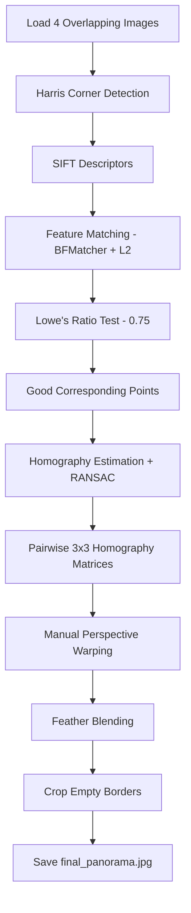

# Panorama Stitching — Four Images

A Computer Vision project that builds a single panorama from **four overlapping images** using a complete feature-based stitching pipeline.

Unlike a one-line `cv2.Stitcher` solution, this notebook implements the main stitching stages manually: **Harris corner detection, SIFT descriptors, feature matching, Lowe’s ratio test, Homography estimation with RANSAC, perspective warping, feather blending, cropping, and saving the final panorama**.

---

## Tools & Libraries

- Python
- OpenCV
- NumPy
- Matplotlib
- Jupyter Notebook / Google Colab

---

## Pipeline Flow



---

## Steps

### 1. Load the Images
The notebook loads **four overlapping images** and displays them before processing.

The images should:
- Belong to the same scene.
- Have enough overlap between neighboring images.
- Contain visible texture and distinctive features.

---

### 2. Harris Corner Detection
Harris corners are used to locate distinctive points in every image.

The notebook uses:

```python
cv2.goodFeaturesToTrack(
    gray,
    maxCorners=1800,
    qualityLevel=0.01,
    minDistance=5,
    useHarrisDetector=True,
    k=0.04
)
```

Each detected corner is converted into a `cv2.KeyPoint` so that SIFT can describe it.

**Output:** a set of keypoint locations `(x, y)` for each image.

---

### 3. SIFT Descriptors
SIFT is used to describe the local appearance around each Harris corner.

```python
sift = cv2.SIFT_create()
keypoints, descriptors = sift.compute(gray, corners)
```

Each keypoint receives a **128-dimensional descriptor**.

**Output:** keypoints + descriptor matrix with shape approximately:

```text
(number_of_keypoints, 128)
```

---

### 4. Feature Matching + Lowe’s Ratio Test
Descriptors are matched between **consecutive image pairs** using a Brute-Force matcher with Euclidean distance:

```python
matcher = cv2.BFMatcher(cv2.NORM_L2)
neighbors = matcher.knnMatch(right_des, left_des, k=2)
```

For every descriptor, the best and second-best matches are compared using Lowe’s ratio test:

```python
best.distance < 0.75 * second.distance
```

This removes ambiguous matches and keeps stronger correspondences.

**Output:** good matches between neighboring images.

---

### 5. Homography Estimation + RANSAC
For every neighboring image pair, matched keypoints are converted into source and destination coordinates.

A **3×3 Homography matrix** is then estimated using RANSAC:

```python
H, mask = cv2.findHomography(
    src,
    dst,
    cv2.RANSAC,
    3.0
)
```

RANSAC rejects geometrically inconsistent matches (outliers) and keeps the inliers that agree with the estimated transformation.

The notebook also checks that enough inliers are available before accepting the Homography.

**Output:** pairwise Homography matrices used to align the images.

---

### 6. Manual Warping + Feather Blending
The images are transformed into a common panorama coordinate system using:

```python
cv2.warpPerspective(...)
```

Instead of relying on `cv2.Stitcher`, the notebook manually builds the panorama canvas.

For blending, a mask is warped with each image and a distance transform is used to calculate blending weights:

```python
weight = cv2.distanceTransform(mask, cv2.DIST_L2, 3)
```

Pixels farther from image borders receive larger weights, producing a smoother transition inside overlapping regions.

The weighted images are accumulated and normalized to create the blended panorama.

---

### 7. Cropping & Saving
After warping, the panorama may contain empty borders.

The notebook detects the valid image region, crops the unused area, and saves the final output as:

```text
final_panorama.jpg
```

---

## Final Pipeline Summary

```text
4 Input Images
      ↓
Harris Corners
      ↓
SIFT Descriptors
      ↓
BFMatcher + KNN Matching
      ↓
Lowe's Ratio Test
      ↓
Good Corresponding Points
      ↓
Homography + RANSAC
      ↓
Perspective Warping
      ↓
Feather Blending
      ↓
Cropping
      ↓
Final Panorama
```

---

## Project Goal

The goal of this project is to understand and implement the main stages behind panorama stitching rather than using a ready-made stitching function. The notebook demonstrates how feature detection, description, matching, geometric alignment, warping, and blending work together to generate one panoramic image from multiple overlapping photographs.
